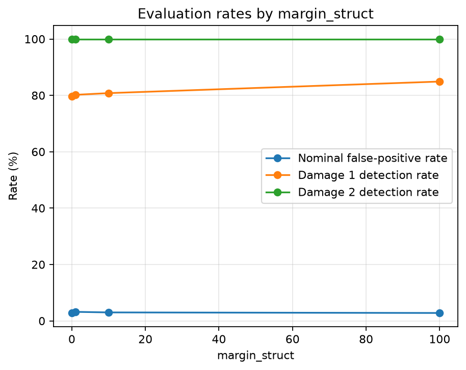

# Hankel Anomaly Detection

This repository refactors a research implementation of Hankel-based anomaly detection into a modular Python project. The original paper is called "Fault Detection on Manifolds of Nonlinear Dynamical Systems with Dual Autoencoders" and can be found in https://arxiv.org/pdf/2608.17698. It separates data loading, model training, evaluation, and experiment tracking, and includes automated tests and GitHub Actions for continuous integration. Therefore, further extensions of the experiments and additions to the source code is under progress

The project is intended as a starting point for making a research implementation more reproducible and easier to maintain.

## 1. Project Features

- MATLAB data loading and input validation.
- A two-stage training pipeline for Hankel-based anomaly detection.
- Ambient training-data generation with configurable `margin_struct`.
- Anomaly scoring and threshold calibration.
- Model and evaluation artifact handling.
- MLflow experiment tracking for training and evaluation.
- Comparison of experiments with different `margin_struct` values.
- Automated tests and code checks through GitHub Actions.

## 2. Requirements and Installation

Python 3.10 or newer is required.

Create and activate a virtual environment in Windows PowerShell from the project root:

```powershell
py -m venv .venv
.\.venv\Scripts\Activate.ps1
python -m pip install --upgrade pip
```

Install the project and its development dependencies:

```powershell
python -m pip install -e ".[dev]"
```

To include MLflow experiment tracking, install the optional tracking dependency as well:

```powershell
python -m pip install -e ".[dev,tracking]"
```

The main dependencies include PyTorch, NumPy, SciPy, and Matplotlib. The development dependencies include pytest and Ruff, while MLflow is installed separately as an optional dependency.

If PowerShell blocks virtual-environment activation, use the environment's Python executable directly:

```powershell
.\.venv\Scripts\python.exe -m pip install -e ".[dev,tracking]"
.\.venv\Scripts\python.exe -m pytest -q
```

## 3. Project Structure

The main components are organized as follows:

- `src/hankel_anomaly/`: reusable modules for data loading, training, evaluation, and experiment tracking.
- `scripts/train_model_mlflow.py`: training entry point with MLflow experiment tracking.
- `scripts/evaluate_model_mlflow.py`: evaluation entry point with MLflow experiment tracking.
- `scripts/compare_mlflow_runs.py`: comparison of recorded MLflow runs.
- `tests/`: automated tests for data preparation, evaluation, and the training pipeline.
- `.github/workflows/tests.yml`: GitHub Actions workflow for running tests and code checks.
- `pyproject.toml`: package configuration, dependencies, and development-tool settings.

## 4. MLflow Experiment Tracking

The project provides separate training and evaluation scripts that use MLflow to organize experiments. This keeps experiment tracking separate from the reusable training and evaluation modules.

The scripts record experiment parameters, training information, evaluation metrics, and artifacts according to their implementations.

Two tracking options are supported: a local MLflow server and a Databricks workspace.

### 4.1. Local MLflow tracking

Install MLflow if you have not already installed it:

```powershell
python -m pip install -e ".[dev,tracking]"
```

Start the local MLflow server in a separate PowerShell terminal from the project root:

```powershell
python -m mlflow server --host 127.0.0.1 --port 5000 --backend-store-uri sqlite:///mlflow.db
```

Keep the server running. The local tracking URI is:

```text
http://127.0.0.1:5000
```

Open this address in a browser to inspect recorded experiments and runs.

When using the local server, ensure that the scripts use the local tracking URI. When using Databricks, configure the tracking URI as described below.

### 4.2. Databricks MLflow tracking

Databricks provides a remote tracking backend for storing and comparing experiments. The project uses the following experiment location:

```text
/Shared/hankel-anomaly-detection
```

The steps below use Windows PowerShell and the Databricks CLI.

#### Step 1: Install the Databricks CLI

Install the Databricks CLI using the [official installation instructions](https://docs.databricks.com/aws/en/dev-tools/cli/install).

Verify that the CLI is available:

```powershell
databricks -v
```

#### Step 2: Create a Databricks authentication profile

A configuration profile stores the workspace connection settings and identifies the authentication configuration used by the CLI and compatible Python tools.

Authenticate interactively using your workspace URL:

```powershell
databricks auth login --host "https://YOUR_DATABRICKS_WORKSPACE_URL" --profile YOUR_PROFILE_NAME
```

Replace the placeholders:

- `YOUR_DATABRICKS_WORKSPACE_URL`: the workspace hostname from your browser's address bar, without additional paths such as `/browse`.
- `YOUR_PROFILE_NAME`: a profile name you choose, for example, `hankel-project`.

For example, the command structure is:

```powershell
databricks auth login --host "https://YOUR_WORKSPACE_HOST" --profile hankel-project
```

The command opens a browser-based authentication flow. Sign in and follow the prompts to complete authentication.

**Important:** Use the base workspace URL, not the URL of a page inside the workspace. If an existing profile contains an incorrect host, use a new profile name for this setup or correct the existing configuration before proceeding.

#### Step 3: Understand the profile configuration file

On Windows, the default Databricks CLI configuration file is:

```text
%USERPROFILE%\.databrickscfg
```

The CLI creates or updates the profile configuration during authentication. You normally do not need to create this file manually.

A profile has a structure similar to the following:

```ini
[hankel-project]
host = https://YOUR_DATABRICKS_WORKSPACE_URL
auth_type = databricks-cli
```

This is an illustrative configuration structure, not a replacement for the authentication process. The CLI manages the authentication credentials, and modern OAuth-based authentication can store tokens in Windows Credential Manager rather than writing them into this file.

If you already have a working profile, you can keep using it. The profile name in the commands below must match the name you configured.

#### Step 4: Verify the profile

List your available profiles and check their validity:

```powershell
databricks auth profiles
```

Inspect the configuration for your chosen profile:

```powershell
databricks auth describe --profile hankel-project
```

Finally, verify that the profile can access the workspace and retrieve your user identity:

```powershell
databricks current-user me --profile hankel-project
```

Replace `hankel-project` if you chose another profile name.

The profile should identify the correct workspace and authenticate successfully before you continue.

#### Step 5: Configure MLflow to use the profile

From the project's PowerShell terminal, select the profile:

```powershell
$env:DATABRICKS_CONFIG_PROFILE = "hankel-project"
```

Configure MLflow to use Databricks tracking:

```powershell
$env:MLFLOW_TRACKING_URI = "databricks"
```

These environment variables apply to the current PowerShell session. Set them again in a new terminal when needed.

Install the tracking dependencies if necessary:

```powershell
python -m pip install -e ".[dev,tracking]"
```

The Python MLflow scripts must use the same Databricks authentication profile and must not override the tracking URI with a local tracking server address.

#### Step 6: Run a tracking test

From the project root, run the MLflow-enabled training script:

```powershell
python scripts/train_model_mlflow.py --margin-struct 100
```

After the run completes, open your Databricks workspace and navigate to the experiment:

```text
/Shared/hankel-anomaly-detection
```

Verify that the run appears with its parameters, metrics, and available artifacts. You can then run the evaluation script and compare the recorded experiments.

**Security note:** Do not commit Databricks credentials, tokens, `.databrickscfg`, or other private configuration files to GitHub. Keep the local authentication profile outside version control.

For additional details, see the official [Databricks CLI authentication documentation](https://docs.databricks.com/aws/en/dev-tools/cli/authentication) and [configuration profiles guide](https://docs.databricks.com/aws/en/dev-tools/cli/auth-config-profiles).

## 5. Data Requirements

Place the four MATLAB files in `data/raw/`:

| File | MATLAB variable | Expected shape |
|---|---|---|
| `H_strongNL_MC.mat` | `H_nom_strong_all` | `(78000, 78)` |
| `H_test_strongNL_MC.mat` | `H_nom_strong_test_all` | `(78, 78, 1000)` |
| `H_s_dmg1_MC.mat` | `H_anom_dmg1_strong` | `(78, 78, 1000)` |
| `H_s_dmg2_MC.mat` | `H_anom_dmg2_strong` | `(78, 78, 1000)` |

These are the expected dimensions for the current dataset configuration. Verify the variable names and shapes against your actual MATLAB files before running the experiment.

The original MATLAB datasets are not included in this repository. Users must obtain the data separately and ensure they have permission to use it.

## 6. Training and Evaluation

### 6.1. Training with different `margin_struct` values

The `margin_struct` parameter controls the expansion of the ambient-data bounds. A value of `0` disables the expansion, while larger values increase the range.

The current experiments investigate four values:

- `100`: wider ambient bounds.
- `10`: moderately expanded ambient bounds.
- `1`: smaller expansion.
- `0`: no expansion.

Run the MLflow-enabled training script from the project root. Each command starts a separate training run with the specified parameter.

**Experiment 1: `margin_struct = 100`**

```powershell
python scripts/train_model_mlflow.py --margin-struct 100
```

**Experiment 2: `margin_struct = 10`**

```powershell
python scripts/train_model_mlflow.py --margin-struct 10
```

**Experiment 3: `margin_struct = 1`**

```powershell
python scripts/train_model_mlflow.py --margin-struct 1
```

**Experiment 4: `margin_struct = 0`**

```powershell
python scripts/train_model_mlflow.py --margin-struct 0
```

The scripts use the configured training parameters and record experiment information through MLflow. Checkpoints and other artifacts are saved according to the project's artifact configuration.

### 6.2. Evaluating the trained models

After training, evaluate each model using the same `margin_struct` value used for its training run.

**Evaluate the model trained with `margin_struct = 100`**

```powershell
python scripts/evaluate_model_mlflow.py --margin-struct 100
```

**Evaluate the model trained with `margin_struct = 10`**

```powershell
python scripts/evaluate_model_mlflow.py --margin-struct 10
```

**Evaluate the model trained with `margin_struct = 1`**

```powershell
python scripts/evaluate_model_mlflow.py --margin-struct 1
```

**Evaluate the model trained with `margin_struct = 0`**

```powershell
python scripts/evaluate_model_mlflow.py --margin-struct 0
```

The evaluation script selects the corresponding training run/model based on `margin_struct`, so a training run ID does not need to be supplied manually.

Make sure the corresponding training run exists and that the checkpoint artifacts are accessible before evaluating a model.

### 6.3. Comparing experiments

After running training and evaluation, use the comparison script:

```powershell
python scripts/compare_mlflow_runs.py
```

The comparison script retrieves the recorded runs and generates a comparison of the available metrics and experiment configurations.

For a meaningful comparison, use consistent evaluation datasets and keep other training settings unchanged when investigating the effect of `margin_struct`.

### Comparison of `margin_struct` settings

To investigate the effect of the structural margin parameter, we compare the evaluation results obtained with `margin_struct` values of 100, 10, 1, and 0. The experiments are tracked using MLflow and evaluated on nominal data and two damage conditions.



The comparison considers the false-positive rate on nominal data and the detection rates for the two damage conditions. These metrics help assess the trade-off between correctly identifying damage and avoiding false alarms.

## 7. Evaluation Method

The evaluation procedure calculates anomaly scores for nominal, damage-1, and damage-2 trials. The threshold is calibrated from nominal data according to the implemented scoring rule.

The reported nominal flagged fraction estimates the empirical false-positive fraction on the nominal test set. The corresponding fractions for damage-1 and damage-2 indicate the empirical detection rates at the selected threshold.

The results depend on the trained model, training configuration, data preparation, and threshold-calibration procedure.

## 8. Testing and Code Quality

Run the automated tests:

```powershell
python -m pytest -q
```

Run the code checks:

```powershell
python -m ruff check src tests
```

The tests cover basic data preparation, evaluation behavior, and the training pipeline. They help detect implementation errors but do not establish the scientific validity of the complete experiment.

GitHub Actions runs tests and code checks automatically on pushes and pull requests.

## 9. Reproducibility Considerations

For meaningful comparisons between experiments:

- Record the random seed and model configuration.
- Keep training, calibration, and final test data separate where possible.
- Verify tensor dimensions at loading, flattening, and reshaping steps.
- Document the dataset version and `margin_struct` value.
- Calibrate the anomaly threshold using the intended nominal calibration data.
- Evaluate both false-positive and damage-detection rates.
- Associate model artifacts and evaluation metrics with their corresponding MLflow runs.

MLflow helps organize experiment metadata and artifacts, but reproducibility also depends on the data, software environment, and training procedure.

## 10. Data and Artifact Management

Raw MATLAB files, model checkpoints, generated plots, and local MLflow tracking databases are not intended to be committed to version control unless there is a deliberate reason to distribute them.

Before publishing the repository, verify that you have permission to redistribute any external datasets and that no credentials or private configuration files are included.
